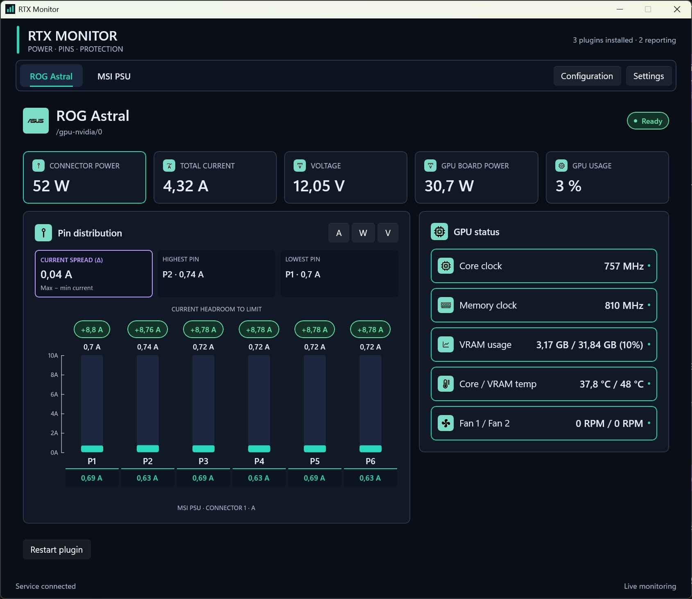
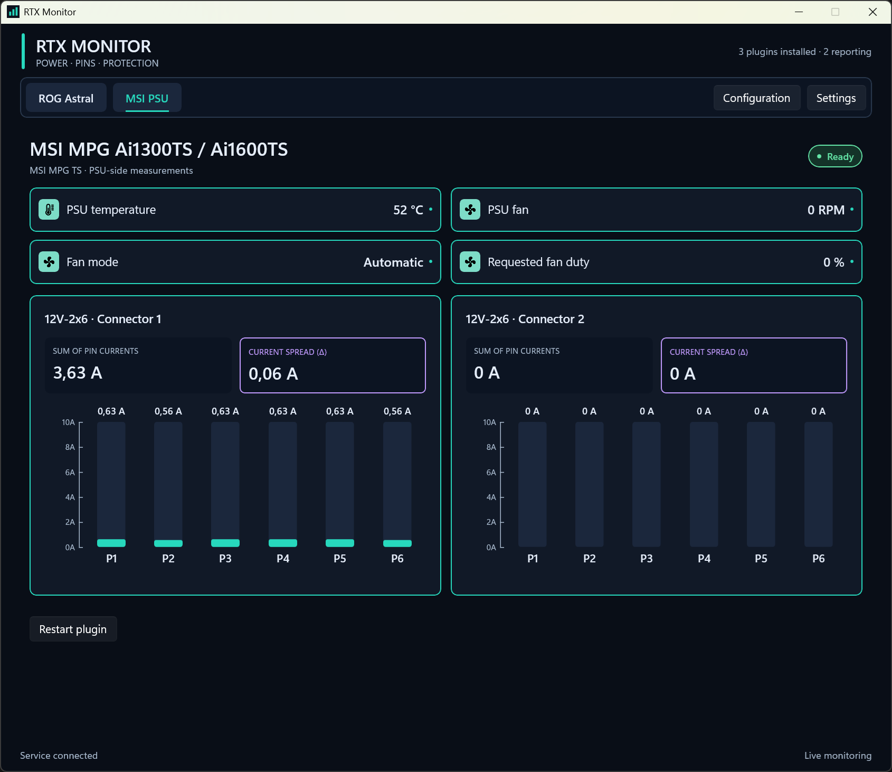
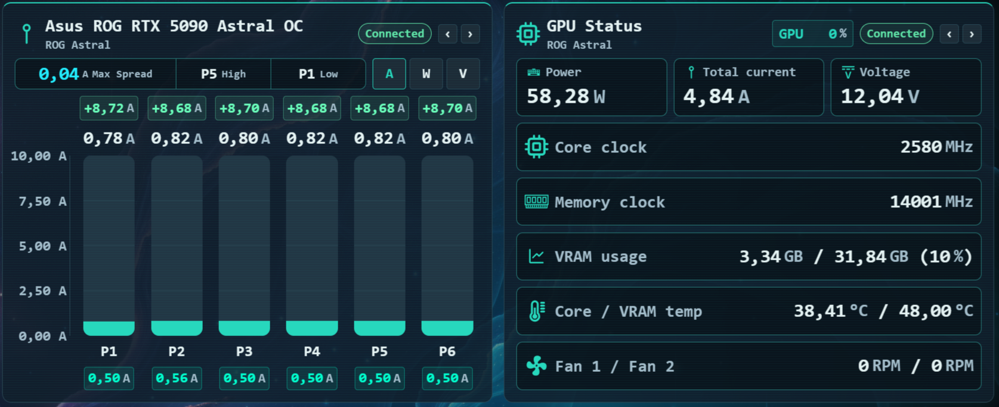
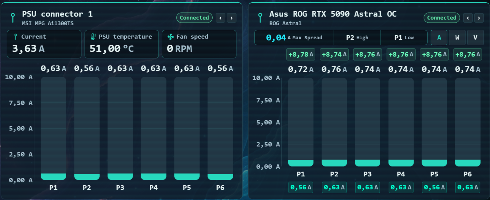

# RTX Monitor

RTX Monitor is a Windows service, desktop app, and Corsair Xeneon Edge iCUE widget for GPU connector and PSU monitoring. View per-pin current, voltage and power, GPU temperatures and clocks, and supported PSU telemetry from one local backend.

The service collects readings and manages warning policies. The desktop app configures the service and provides a monitoring dashboard and Windows notifications. The widget provides a customizable, read-only display in iCUE.

## Screenshots

### Desktop app

**ASUS ROG Astral** - live connector metrics, per-pin distribution, GPU status and MSI PSU current comparison.



**MSI PSU** - temperature, fan status and per-pin current for both PSU connectors.



### Xeneon Edge widget

**ASUS ROG Astral** - pin distribution and GPU status, with PSU current displayed beneath the GPU pins.



**MSI PSU and ASUS comparison** - independently configured panels show the PSU connector and GPU-side pin currents together.



## Supported hardware

| Plugin | Hardware | Available features |
|---|---|---|
| WireView | Thermal Grizzly WireView Pro II, including Noctua Edition recognition | Six-pin current, voltage and power; board and external-probe temperatures; cable rating; fault status/log; read-only device settings and fault clearing. |
| ASUS | Supported ASUS ROG Astral GPUs | Per-pin connector telemetry, power and current totals, clocks, core/VRAM temperatures, fan speeds, GPU usage and VRAM usage. |
| MSI PSU | MSI MPG Ai1300TS and MPG Ai1600TS | Per-pin current for two PSU connectors, connector current totals, PSU temperature, fan telemetry and optional fan control. |

Readings depend on the connected hardware and its available sensors. Generic GPU telemetry can be available without Astral per-pin sensors. The MSI Ai1300TS has been tested on hardware; Ai1600TS and WireView Noctua model recognition do not imply separate hardware verification.

## Features

- Live dashboards with current, power and voltage charts, pin spread, headroom, temperatures and device status.
- Independent plugin enablement, polling intervals and freshness settings.
- Optional MSI PSU current beneath WireView or Astral pins, with an independent connector selector for each chart.
- Plugin-owned warning definitions with shared notification policies, per-warning overrides, optional repeat reminders and recovery confirmation.
- Desktop tray operation, per-user Start with Windows and start-minimized options.
- A read-only Xeneon Edge widget supporting S/M/L/XL slots in landscape and portrait, with configurable panel content and order, fonts, sizes, colors, charts and image backgrounds.
- A separate debug console for telemetry simulation in Debug or explicitly debug-enabled builds.

The service continues monitoring when the desktop app is closed. Windows notifications require the desktop app to remain running, including in the tray. The widget connects directly to the service and does not require the desktop app to remain open.

## Install

Use a release ZIP from [GitHub Releases](https://github.com/Codeh4ck/RTX5090Monitor/releases), or build one from source.

1. Extract the ZIP and run `RtxMonitor-Setup-<version>-win-x64.exe`.
2. Install the required monitoring service. The desktop app is optional, but is needed to configure the backend conveniently.
3. Open RTX Monitor and enable/configure the plugins for your hardware.
4. To use Xeneon Edge, import the included `rtx5090monitor.icuewidget` into iCUE and assign it to a widget slot.

The installer targets Windows x64 and accepts Windows 10 build 17763 or later, including Windows 11. Published packages include the .NET and Windows App SDK runtimes and the Microsoft Visual C++ prerequisite. Using the widget additionally requires compatible iCUE software and a Xeneon Edge display.

The backend listens on `localhost:59273` and starts automatically with Windows. Another process using that port must be stopped before the backend can start.

### Updates and uninstall

Exit the desktop app through its tray menu, then run the newer installer. Installer-managed installations upgrade in place and retain service configuration, desktop preferences and component choices.

Import the newer widget into iCUE separately; the installer does not replace imported widgets. Keep the service, desktop app and widget on matching release versions.

Use Windows Settings > Apps > RTX Monitor to modify, repair or uninstall, or rerun the setup executable. The included uninstall script opens the registered uninstaller. Uninstall retains backend settings and desktop preferences; remove the widget separately in iCUE.

## Configuration

Use the desktop app's **Configuration** page for plugin settings, Sensor stream, source selections, warnings and backend maintenance.

- **Sensor stream** controls how often the backend publishes aggregate snapshots. Hardware polling is configured independently for each plugin.
- **Source selections** define preferred sensor sources and fallback behavior for consumers that request named selections.
- **Warnings** control initial Windows notifications, optional reminders and clear confirmation, with per-warning overrides. The default reminder interval is five seconds; repeating reminders are off by default.
- **MSI PSU settings** include fan-control options and desktop PSU pin-comparison preferences. Fan control defaults to leaving the existing device mode untouched.

Backend configuration is stored at `%ProgramData%\Rtx5090Monitoring\appsettings.json`. Desktop preferences are stored under `%LocalAppData%\Rtx5090Monitoring`. Configuration changes apply live through the desktop app or service API.

The widget's iCUE settings affect presentation only. Double tap outside its controls to open the scrollable, read-only backend configuration view. See the included [widget setup instructions](XeneonEdgeWidget/INSTALL.md) for operation and display settings.

## Build from source

Build on Windows with the .NET 10 SDK. Widget builds additionally require Node.js 22.18 or later, npm and the iCUE Widget CLI (`icuewidget`) on `PATH`. Release packaging uses PowerShell 7 and restores the WiX SDK through NuGet.

### Service

```powershell
dotnet build Rtx5090Monitoring.Service -c Release
```

### Desktop app

```powershell
dotnet publish UI/Rtx5090Monitoring.App -c Release -p:PublishProfile=Portable -p:EnableTelemetryDebug=false
```

The portable app is written to `artifacts/desktop/win-x64/`. Keep that entire directory together, including assets, native libraries and runtime files.

For development, open `Rtx5090Monitoring.slnx` in Rider or Visual Studio. Debug builds include the telemetry debug console; ordinary Release builds exclude simulation and diagnostic functionality. Use the installed backend for live monitoring, or stop it before running another backend on the same port.

### Xeneon Edge widget

```powershell
cd XeneonEdgeWidget
npm ci
npm run build
npm run verify
```

`npm run build` type-checks, runs widget tests, generates iCUE metadata, validates and creates the single `.dist/rtx5090monitor.icuewidget` package at the solution root. `npm run verify` checks the generated widget in a browser using simulated telemetry. Browser verification uses Microsoft Edge by default; `PLAYWRIGHT_CHANNEL` can select another installed supported browser channel.

### Complete release ZIP

From the solution root:

```powershell
./scripts/Build-Release.ps1 -Version 1.0.0
```

Use the intended release version and keep widget manifest/package versions aligned. The script runs checks, publishes the service and desktop app, packages the widget, builds and inspects the installer, collects third-party notices and produces a ZIP under `.dist/releases/<version>/`. It downloads and verifies the Microsoft Visual C++ prerequisite when needed. Code signing is optional and supported by the release script's certificate parameters.

Building the release does not install it or restart the installed backend.

## Update checks

The desktop app and widget can check for updates automatically at startup and on a Daily, Weekly or Monthly schedule. Turning automatic checks off leaves manual checks available. Updates open the matching GitHub release in the system browser; installation and iCUE import remain manual.

The desktop app compares its own version and the running backend's `GET /version` response. The widget compares its bundled version and uses iCUE's Link Provider to open release links. Older backends without the version endpoint remain usable and display an unavailable version.

Use **Settings > Software updates** in the desktop app. Widget scheduling is under **Panels and telemetry**; double tap the widget and choose **Check for software updates** for manual checks. Remind me later suppresses that component/version for 24 hours, while Skip this version suppresses it until another version is published. Saved update notices are separate from hardware warnings.

`version.json` is the authoritative JSON manifest for desktop, service and widget versions. Builds embed those versions. Publish the matching Git tag and upload `version.json` alongside the release ZIP. The desktop reads the latest release's manifest asset; the widget resolves the latest stable published tag and reads that tag's manifest to support browser cross-origin restrictions. Do not advertise an unreleased development manifest as the latest release.

## Tests

From the solution root:

```powershell
dotnet run --project Rtx5090Monitoring.Tests -c Release
dotnet run --project UI/Rtx5090Monitoring.UI.Tests -c Release -p:EnableTelemetryDebug=false
dotnet run --project Installer/Rtx5090Monitoring.Installer.Tests -c Release

cd XeneonEdgeWidget
npm ci
npm run check
npm test
```

Normal automated tests use simulated hardware. Explicit hardware verification and installer acceptance are separate operations. `scripts/Test-InstallerVm.ps1` is intended only for a disposable Windows VM because it installs and removes the product.

## Repository layout

| Path | Purpose |
|---|---|
| `Rtx5090Monitoring.Service/` | Windows service, configuration persistence and HTTP/WebSocket host. |
| `Rtx5090Monitoring.Core/`, `Rtx5090Monitoring.Contracts/`, `Rtx5090Monitoring.Warnings/` | Shared contracts, plugin lifecycle, sensor state and warning scheduling. |
| `Rtx5090Monitoring.Plugins.*/` | Hardware plugins, their contracts and analysis code. |
| `UI/` | WinUI desktop app, service client, presentation models, debug support and UI tests. |
| `XeneonEdgeWidget/` | Widget source, resources, tests and build tools. |
| `Installer/`, `scripts/` | Setup/uninstall implementation and release tooling. |
| `assets/screenshots/` | Screenshots used by this README. |

## Local API

The desktop app and widget consume the same local service. Main routes include:

| Route | Purpose |
|---|---|
| `GET /health` | Service and plugin health. |
| `GET /version` | Schema version and the running backend binary version. |
| `GET /plugins` | Installed plugins, capabilities and warning definitions. |
| `WS /sensors` | Typed snapshots for all reporting plugins, including warning states and notification sequences. |
| `GET /configuration` | Current configuration, revision and validation status. |
| `PUT /configuration` | Update configuration; supports `If-Match` concurrency checks. |
| `GET/PUT /plugins/{pluginId}/settings` | Plugin-specific settings. |
| `POST /plugins/{pluginId}/restart` | Restart one plugin. |
| `POST /restart` | Restart the installed backend through Windows Service recovery. |

Plugin IDs are `wireview-pro2`, `asus-astral` and `msi-psu`. Device-specific routes are exposed under each plugin's prefix. The aggregate sensor WebSocket is read-only and does not accept client commands.

## License

See [LICENSE.md](LICENSE.md). Third-party attribution is included in the [installer notices](Installer/Resources/THIRD-PARTY-NOTICES.txt) and [widget notices](XeneonEdgeWidget/THIRD-PARTY-NOTICES.md).
